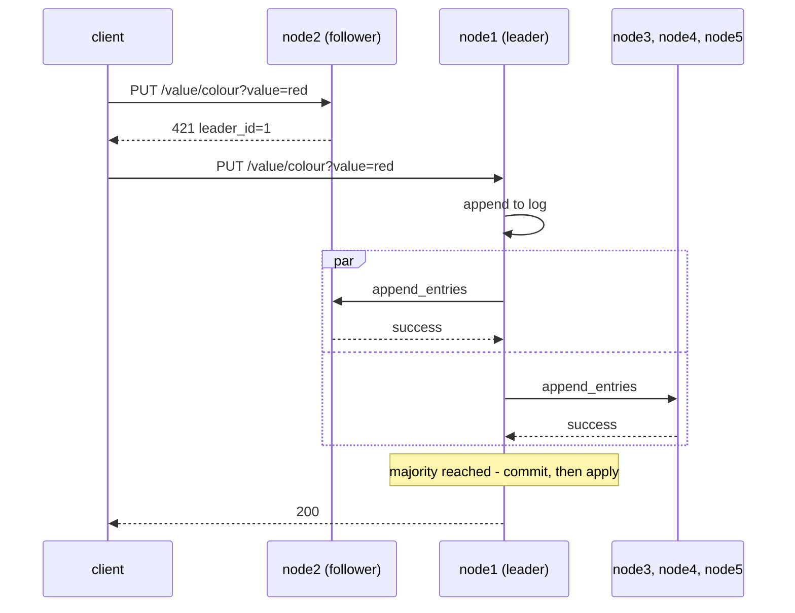

# Raft Key-Value Store 

Python implementation of the Raft Consensus Algorithm, forming a distributed key-value store over HTTP. It consists of five nodes, leading to a quorum of three, and allowing two node failures. 

Implementation is foundationally based on the ideas and concepts expressed in "[In Search of an Understandable Consensus Algorithm](https://raft.github.io/raft.pdf)" by Diego Ongaro and John Ousterhout.

## Demo

### Following the leader

[`client.py`](client.py) selects a node at random and attempts to write to it. If that node isn't the leader it will retry, following the leader id given until the write succeeds, or reaches the maximum number of attempts.  

Once the cluster is up run:
```bash
uv run python client.py
```

Example output:
```
Successful put after 2 attempts
Successfully retrieved correct value after 1 attempts
```

### Surviving a leader kill

[`demo_failover.py`](demo_failover.py) finds the leader through the `/` endpoint, kills that container, writes again while the cluster elects a replacement, and restarts the node afterwards: 

```bash 
uv run python demo_failover.py
```

Example output:
```
Set colour=red after 1 attempts
Killing the leader (node1)
Set colour=blue after 2 attempts
Read back colour=blue after 1 attempts
Restarting node1
```

The second write can cost more attempts than the first - those are the retries spent waiting for a new leader to be elected.

Nothing is forwarded between nodes, so the client does the work - see [Finding the Leader](#finding-the-leader).

## Quick Start

Dependencies: [Docker](https://docs.docker.com/get-started/get-docker/) and [uv](https://docs.astral.sh/uv/getting-started/installation/)

```bash
cp .env.example .env 
# set CLUSTER_SECRET to any random string
docker compose up 

curl http://localhost:8001 # check up
```

Each node is published on its own port, `node1` on 8001 through to `node5` on 8005.

The `CLUSTER_SECRET` environment variable is shared by every node and required on the internal API endpoints. Compose passes it as `${CLUSTER_SECRET-}`, so an unset value lets the node start with the check skipped rather than failing. For reference see [`.env.example`](.env.example).

There are two compose modes:

- `docker compose up` merges [`docker-compose.override.yml`](docker-compose.override.yml) automatically. It mounts the working tree, runs uvicorn with `--reload`, and sets the `DEBUG_ENDPOINTS` environment variable, providing the debugging API endpoints.

- `docker compose -f docker-compose.yml up` runs the deployment shape. It copies the code (instead of mounting), has no automatic reload, and does not include the debug endpoints. Use this when measuring anything: `--reload` restarts a node every time you save a file, and a restarting node triggers an election.

To stop the cluster and wipe the volumes:

```bash
docker compose down -v
```

Omit `-v` to keep the data - each node will pick its log and data back up on the next start.

## Tests

```bash
uv run pytest
```

The test suite calls the node's methods directly (instead of interacting with the individual containers and their ecosystem using HTTP). Each test uses its own `RaftNode` with its own temporary SQLite file. It is also configured with the addresses of four other nodes (that don't exist), so the majority arithmetic matches the real five-node cluster. 

| Test File                 | Covers |
| ------------------------- | ------ |
| `test_append_entries.py`  | Term handling, the log consistency check, truncation and `commit_index` |
| `test_request_vote.py`    | One vote per term, the log-up-to-date rule, and pre-vote |
| `test_commit_index.py`    | The majority arithmetic deciding what is committed |
| `test_apply_log.py`       | Committed entries reaching the data table - once, in order, in one commit |
| `test_storage.py`         | Log density across truncation, write-through, and the commit boundaries |
| `test_client_contract.py` | The 421 and 503 responses a client actually sees |

Elections and failover are not covered, since driving them over HTTP is slow and timing dependent. [`demo_failover.py`](demo_failover.py) is the test for that behaviour. Two things are also left: the leader's handling of `append_entries` replies (as it requires an HTTP client), and the 403 error on a missing `X-Cluster-Secret` (as it requires the FastAPI routes).

## API

### Client Endpoints

| Method | Path           | Description |
| ------ | -------------- | ----------- |
| GET    | `/value/{key}` | Reads the stored value at `key` |
| PUT    | `/value/{key}` | Stores `?value=` at `key`, returning the old value |
| DELETE | `/value/{key}` | Deletes the stored value at `key`, returning it |
| GET    | `/`            | Reports `node_id`, `state` and `leader_id`. The only endpoint that needs no consensus, so it answers even mid-election |

Full request and response schemas are served by Swagger UI at [/docs](http://localhost:8001/docs) on any node.

Example API usage. Note that `value` is a query parameter, not a body:

```bash
# against the leader (e.g. node1)
$ curl -X PUT "http://localhost:8001/value/foo?value=bar"
{"key":"foo","new_value":"bar","old_value":null}

# against a follower (e.g. node2)
$ curl -X PUT "http://localhost:8002/value/foo?value=bar"
{"detail":{"error":"not leader","leader_id":"1"}}
```

### Internal Endpoints

The two Raft RPCs. These are for peers, not clients, and both require the `X-Cluster-Secret` header:

| Method | Path              | Description |
| ------ | ----------------- | ----------- |
| POST   | `/request_vote`   | A candidate asks for a vote. `pre_vote=True` asks whether the vote *would* be granted without anyone changing their term - see [Elections](#elections) |
| POST   | `/append_entries` | The leader replicates entries and reports its commit index. Also the heartbeat, sent with no entries |

The two internal endpoints answer `403` on a bad or missing `X-Cluster-Secret`. They also share the client port, which is a known weakness - see [Limitations](#limitations).

### Status Codes

| Code  | Meaning |
| ----- | ------- |
| `200` | Success. A `GET` for a key that was never set is also a `200`, with `"value": null` |
| `421` | This node is not the leader. The body names the leader - see [Finding the Leader](#finding-the-leader) |
| `422` | The `value` query parameter is missing from a `PUT` |
| `503` | `entry not applied in time`. The entry reached the log but was not applied within 10s; it may still commit later - see [Limitations](#limitations) |

### Finding the Leader

Requests are not forwarded between peers. Followers reject reads and writes with a 421 error, and instead will name the current leader.

The client is then expected to retry the request against the named leader, as specified in §8 of the Raft paper. The 421 body carries the leader's id rather than its address, so a client needs its own mapping of node id to url - see [`client.py`](client.py).

That id is not always usable. During an election there is no leader yet, so it comes back `null`. On a read, a leader still waiting for acknowledgements from its peers names itself. In both cases the client should retry, capping the number of attempts rather than following the pointer in a loop.

### Debug Endpoints

These endpoints will give a 404 unless `DEBUG_ENDPOINTS` is set. It is set through the development compose mode - see [Quick Start](#quick-start).

| Method | Path           | Description |
| ------ | -------------- | ----------- |
| GET    | `/debug/data`  | Fetches all key-value pairs in a json format |
| GET    | `/debug/log`   | Fetches the node's stored log |

Both answer from the node's local state, with no leader or majority check, so they can return stale data.

`/debug/log` returns the entries in order:

```json
[
    {"index": 1, "term": 2, "operation": {"type": "NOOP", "key": null, "value": null}},
    {"index": 2, "term": 2, "operation": {"type": "PUT", "key": "foo", "value": "bar"}},
    {"index": 3, "term": 2, "operation": {"type": "DELETE", "key": "foo", "value": null}}
]
```

## Architecture

Data is stored consistently across the nodes by:
- The client sends an HTTP request to the leader, having been turned away by any follower it tried first
- The leader appends the operation to its log and replicates it to the followers
- Each follower checks the entry lines up with its own log, then appends it
- The leader waits for a majority to acknowledge, then commits, applies and replies



### File Map

| File                 | Description                                                       |
| -------------------- | ----------------------------------------------------------------- |
| `raft_node.py`       | All consensus logic - elections, replication, and the loops below |
| `storage.py`         | SQLite persistence for the data, log and term/vote state          |
| `models.py`          | Pydantic models for the RPCs, log entries and node state          |
| `server.py`          | FastAPI routes, and the lifespan that starts the node loops       |
| `client.py`          | Example client - follows 421s to find the leader                  |
| `demo_failover.py`   | Kills the leader mid-run and checks the write survives            |
| `tests/`             | Unit tests for the consensus logic - see [Tests](#tests)          |

### Node Loops

In `raft_node.py` the `run_node()` function starts two asyncio tasks:
- `heartbeat_loop()` fires a replication round every 50ms while this node is the leader, sending each follower the entries it is missing
- `run_node()` itself applies any committed entries and runs the randomised 150-300ms election timer, starting an election if no leader has been heard from

They are separate tasks on purpose. If run sequentially, the lock held while entries are applied can block heartbeats from being sent. This meant that the gaps between heartbeats were long enough to pass the election timeout, which cost a healthy leader its leadership. Concurrent tasks allow heartbeats to be sent while logs are updated.

### Elections

A node that hasn't heard from a leader before its election timer runs out campaigns for the term itself. Before touching its own term it sends a round of `request_vote` with `pre_vote=True`, carrying the term it *would* move to. Peers answer as if the request were real but change nothing, and only if a majority would vote for it does the candidate increment its term and run the election for real. This means a node that was paused or partitioned can rejoin without bumping the term and deposing a healthy leader. Pre-vote is an extension to standard Raft, which comes from §9.6 of Ongaro's "[Consensus: Bridging Theory and Practice](https://web.stanford.edu/~ouster/cgi-bin/papers/OngaroPhD.pdf)".

A new leader's first act is to append a `NOOP` entry, which is what lets entries inherited from an earlier term commit without waiting for the next client write to come along.

### Reads from the Leader

Reads go through the leader, which confirms a majority is still following it before answering - a leader that has been deposed but hasn't noticed yet shouldn't serve stale data. If a majority hasn't acknowledged within an election timeout the read is refused with a 421, and that 421 names this node, which is why a client has to cap its retries (see [Finding the Leader](#finding-the-leader)).

### Storage

A single SQLite file composed of three tables is used to store data: 
- `data` stores the key value pairs
- `log` stores the log of operations, stored to disk for durability
- `raft_state` stores the other persistent state (`current_term` and `voted_for`) as well as `last_applied`

Worth knowing:
- `last_applied` is updated in the same transaction as the data it applies, so a crash can't leave the two disagreeing
- The log is also held in memory so reads aren't held waiting while reading from disk.
- `current_term` and `voted_for` are written to disk together, in one commit. This is to ensure that if a new term is stored with the previous term's vote, a restart won't allow that node to vote a second time in the same term
- A node persists its term, vote and any new entries before it replies to an RPC, so it never acknowledges something a restart could lose

### Environment Variables

| Variable          | Description                                                              | Default    |
| ----------------- | ------------------------------------------------------------------------ | ---------- |
| `NODE_ID`         | Identifier for this node, used for `voted_for` and `leader_id`           | required   |
| `PEERS`           | Comma-separated `host:port` list of the *other* nodes                    | empty      |
| `DB_PATH`         | Path to the SQLite file holding the data, log and term/vote state        | `raft.db`  |
| `CLUSTER_SECRET`  | Shared by every node, required for the two Raft RPC endpoints            | empty      |
| `DEBUG_ENDPOINTS` | Registers `/debug/data` and `/debug/log` API routes when set to anything | unset      |

Compose sets the first three per node - `NODE_ID` 1 to 5, `DB_PATH` as `/data/raft.db` on each node's volume, and `PEERS` as the other four. `CLUSTER_SECRET` comes from `.env` and `DEBUG_ENDPOINTS` is set only by the override, behaving as described in [Quick Start](#quick-start).

Peer addresses use the container-internal port 8000, not the host-mapped 8001 to 8005. Note also that `NODE_ID` and the peer addresses are separate identifiers for the same node, and nothing maps between them.

## Limitations

- Currently no snapshotting, so the log grows indefinitely and must be loaded every time a node is started.
- Slow log backtracking. Currently the leader drops a follower's next index by one per round trip, so a node starting from an empty log catches up very slowly.
- Membership is currently static, so the cluster can't alter in size without a restart.
- A failed write may still have succeeded. A 421 or 503 doesn't mean the entry was not stored, as anything already replicated to a majority gets committed by the next leader. Essentially the request could have failed, but the operation succeeded. 
- `CLUSTER_SECRET` is static and shared by every node, so there is currently no way to revoke one node's access without changing the secret and restarting all of them. A compromised node keeps full RPC access until then.
- The Raft RPCs share a port with the client API, protected only by that secret. They should ideally be split into two, one for clients, and one for nodes/peers.